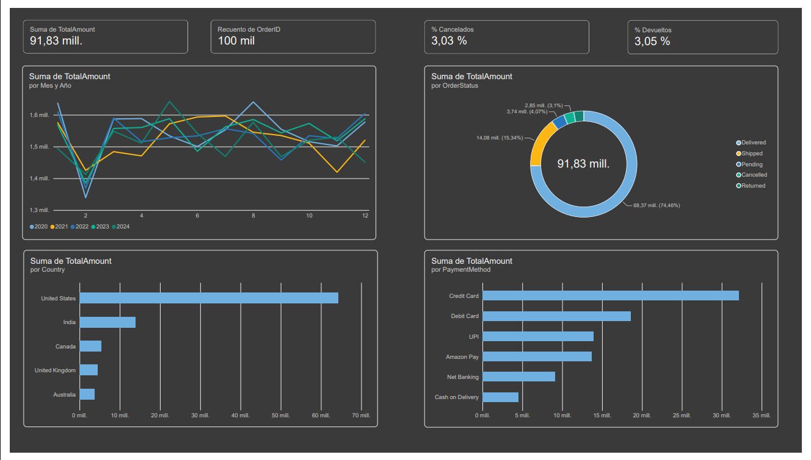

# Análisis de ventas de comercio electrónico (estilo Amazon)

## Objetivo

Analizar 100.000 transacciones de venta de comercio electrónico para responder preguntas de negocio sobre ventas por periodo, categoría, país, método de pago y estado de los pedidos, y presentar los resultados en un dashboard de Power BI.

Preguntas que guían el análisis:

1. ¿Cómo evolucionan las ventas por año y por mes?
2. ¿Qué categorías, países y métodos de pago generan más ingresos?
3. ¿Qué porcentaje de pedidos se cancela o se devuelve?

## Fuente de los datos

Dataset: rohiteng/amazon-sales-dataset (Kaggle).

Contiene 100.000 pedidos y 20 columnas, con información de pedido, cliente, producto, precios, descuentos, impuestos, envío, pago, logística y estado del pedido. Cubre fechas del 1 de enero de 2020 al 28 de diciembre de 2024.

Aclaración importante: el dataset es sintético. Sus datos fueron generados artificialmente para simular comercio electrónico, por lo que los resultados describen el dataset y no el comportamiento real de Amazon.

## Herramientas

- Microsoft Excel: limpieza, validación y cálculos previos.
- Power BI Desktop: modelo de datos, medidas DAX y dashboard.

## Proceso

### 1. Preparación de los datos

- Se separaron las columnas del archivo CSV con la función Texto en columnas.
- Se verificó que no hubiera celdas vacías en las 20 columnas.
- Se detectó y eliminó 1 registro duplicado por OrderID. Después se comprobó que no quedaran duplicados.
- Se verificó que las fechas estuvieran en formato de fecha válido.
- Se confirmó que Quantity, UnitPrice y TotalAmount fueran números, sin valores en cero o negativos.
- Se comprobó que las columnas Discount y Tax son porcentajes (por ejemplo, 0,05 equivale a 5 %).
- Se validó TotalAmount con la fórmula precio × cantidad × (1 − descuento) × (1 + impuesto) + envío. Las 100.000 filas coinciden.
- Se revisaron los valores de Category, PaymentMethod, OrderStatus y Country. No hay variantes de escritura.
- Se crearon las columnas Año y Mes a partir de OrderDate.

### 2. Modelo y medidas en Power BI

Se importó la hoja de Excel limpia y se eliminaron las columnas de revisión. Se definieron dos medidas:

- % Cancelados = DIVIDE(COUNTROWS(FILTER(Amazon, Amazon[OrderStatus] = "Cancelled")), COUNTROWS(Amazon))
- % Devueltos = DIVIDE(COUNTROWS(FILTER(Amazon, Amazon[OrderStatus] = "Returned")), COUNTROWS(Amazon))

### 3. Dashboard

El dashboard tiene cuatro tarjetas (ventas totales, número de pedidos, % cancelados y % devueltos) y cuatro gráficos (ventas mensuales por año, estados del pedido, ventas por país y ventas por método de pago).

## Hallazgos principales

Ventas por año (en unidades monetarias del dataset):

- 2020: 18.529.864
- 2021: 18.248.575
- 2022: 18.367.248
- 2023: 18.513.912
- 2024: 18.166.049

Total del periodo: 91,83 millones de ventas con 100.000 pedidos. Las ventas se mantienen estables entre años, sin crecimiento ni caída claros.

Ventas por mes: febrero es el mes con menores ventas en la mayoría de los años, y enero el de mayores ventas en el total acumulado. La variación entre meses es pequeña.

Estado de los pedidos (participación en el valor total):

- Entregados: 74,46 %
- Enviados: 15,34 %
- Pendientes: 4,07 %
- Cancelados: 3,03 %
- Devueltos: 3,05 %

Categorías: las seis categorías tienen ventas muy parecidas, entre 15 y 15,5 millones cada una. Electronics es la primera, por una diferencia muy pequeña.

Países: Estados Unidos concentra la mayor parte de las ventas, con más de 60 millones. India es el segundo mercado.

Métodos de pago: Credit Card es el método con más ventas, con cerca de 32 millones, seguido de Debit Card.

## Limitaciones

- Al ser un dataset sintético, los patrones (estacionalidad leve, categorías casi iguales, distribución de estados) pueden no reflejar un negocio real.
- No incluye costos ni márgenes, por lo que el análisis se limita a ingresos y no a rentabilidad.
- Los totales incluyen pedidos cancelados y devueltos. Se reportan por separado, pero no se restaron del total de ventas.
- Los pedidos enviados y pendientes suman cerca de 19 % del valor. En un negocio real, esto sería un punto de atención sobre la logística.

## Estructura del proyecto

- Amazon_limpio (1).xlsx: datos limpios con las columnas Año y Mes.
- Analisis-Amazon.pbix: archivo de Power BI con el modelo, las medidas y el dashboard.
- dashboard.png: captura del dashboard.
- README.md: este documento.

## Autor

Adonis Fajardo Rojas
